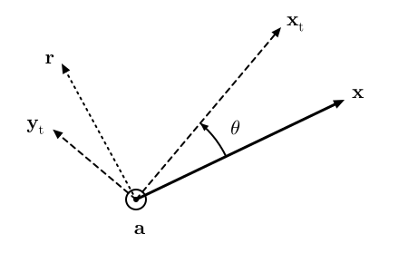

## Description

The pointing error of an attitude controller. The target attitude has its $x$ axis along
`direction` (a thrust or nose direction). Its $y$ axis lies as close to `rollReference` as
possible. The output `error` is the rotation, about the vehicle's own axes, that would bring the
vehicle onto the target. It is exact for small errors, and it keeps its full size up to half a
turn, so a vehicle pointing backwards still turns round.

The vehicle's axis $\mathbf{x}$ must turn by $\theta$ onto the target $\mathbf{x}_t$, about the
axis $\mathbf{a}=\mathbf{x}\times\mathbf{x}_t$, which points out of the page here. The target's
$\mathbf{y}_t$ is the roll reference $\mathbf{r}$ made perpendicular to $\mathbf{x}_t$.

## Assumptions

The direction and the roll reference must not be parallel. Pointing comes first: the roll error
fades out while the pointing error is large and acts fully once the vehicle points. At exactly
half a turn every axis is a shortest turn. A small bias about $z$ then picks one, so the error
never vanishes there.

## Equations

$$\mathbf{x}_t=\frac{\mathbf{d}}{|\mathbf{d}|},\qquad \mathbf{z}_t=\frac{\mathbf{x}_t\times\mathbf{r}}{|\mathbf{x}_t\times\mathbf{r}|},\qquad \mathbf{y}_t=\mathbf{z}_t\times\mathbf{x}_t,\qquad \mathbf{C}=\mathbf{R}\,\mathbf{R}_t^{T}$$

$$\theta=\operatorname{atan2}\left(\sqrt{C_{21}^2+C_{31}^2},\;C_{11}\right),\qquad \mathbf{a}=\left(-C_{31},\;C_{21}+0.05\,(1-C_{11})\right)$$

$$(e_2,e_3)=\theta\,\frac{\mathbf{a}}{|\mathbf{a}|},\qquad e_1=\operatorname{atan2}\left(C_{32}-C_{23},\;C_{22}+C_{33}+2\,(1-C_{11})\right)$$

| Symbol | Meaning | Unit |
|---|---|---|
| $\mathbf{d}$ | `direction`: where the $x$ axis should point, world frame | 1 |
| $\mathbf{r}$ | `rollReference`: where the $y$ axis should point, roughly | 1 |
| $\mathbf{R},\mathbf{R}_t$ | Orientation of the vehicle and of the target (rows: their axes) | 1 |
| $\mathbf{C}$ | The target's axes in vehicle coordinates | 1 |
| $\theta$ | Angle between $\mathbf{x}$ and $\mathbf{x}_t$ (`angle`) | rad |
| $e_1,e_2,e_3$ | `error` about the vehicle's $x$, $y$, $z$ axes | rad |

## How to use

Feed one controller per axis (`PID`, or a rate loop inside an angle loop) whose outputs are
moments: gimbal angles, flap deflections, thrusters. Limit the commanded turn rate to what the
actuators can stop (`VariableLimiter`), so a large turn such as a flip does not overshoot. Drive
`direction` from `LocalDirection` in an ascent, from `EntryAttitude` in an entry and from
`PoweredDescent` in a landing.

## Validation

`unit.aerospace` checks a 0.1 rad turn about $z$: the angle is exact and the error is (0, 0, 0.1).
For a vehicle pointing the other way, the error is $\pi$ about $z$.

## References

B. Wie, *Space Vehicle Dynamics and Control*, 2nd ed., AIAA, 2008, chapter 7.
