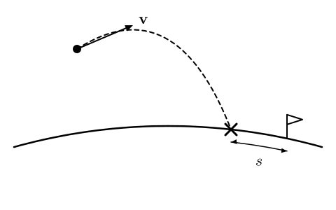

## Description

The instantaneous impact point. This is where a vehicle coasting from here, in vacuum on its
Kepler arc, would meet the Earth's surface, carried round by the Earth's rotation during the
fall. The block also says where that point is from a target. `rangeToGo` is measured along the
ground line from the target towards the vehicle, positive on the vehicle's side; `crossRange` is
measured across it. A booster's boostback burn runs until its impact point has come back to the
landing site, or a little past it, since drag will shorten the fall.

The vehicle, coasting with velocity $\mathbf{v}$, would come down at the cross. The range to go
$s$ runs from the impact point to the target (the flag).

## Assumptions

There is no drag and the Earth is a sphere of radius $R_e$. The arc must come down. For an orbit
that never meets the surface the outputs have no meaning. At or below the surface, the impact
point is where the vehicle is. Drag shortens a real fall; aim a little
long, as the `StarshipMission` booster does with its range bias.

## Equations

From $\mathbf{r},\mathbf{v}$: the conic's semi-latus rectum $p=h^2/\mu$, its eccentricity $e$
and its perifocal axes $\mathbf{P}$ (towards the periapsis) and $\mathbf{Q}$. The impact is on
the descending branch where the radius equals $R_e$:

$$\frac{p}{1+e\cos\nu_i}=R_e,\qquad \nu_i=2\pi-\arccos\frac{p/R_e-1}{e},\qquad \mathbf{r}_i=R_e\left(\cos\nu_i\,\mathbf{P}+\sin\nu_i\,\mathbf{Q}\right)$$

The time of flight $t_f$ follows from Kepler's equation between the eccentric anomalies now and
at impact. The impact point turns with the Earth into Earth-fixed axes:

$$t_f=\frac{(E_i-e\sin E_i)-(E_0-e\sin E_0)}{n}\bmod\frac{2\pi}{n},\qquad \mathbf{r}_{i,\text{ECEF}}=\mathbf{R}_z\!\left(\theta_0+\omega_E\,(t+t_f)\right)\mathbf{r}_i$$

With $\hat{\mathbf{t}}$ the target's direction and $\hat{\mathbf{u}}$ the ground direction from
the target towards the vehicle:

$$s=R_e\operatorname{atan2}\left(\hat{\mathbf{e}}_i\cdot\hat{\mathbf{u}},\;\hat{\mathbf{e}}_i\cdot\hat{\mathbf{t}}\right),\qquad c=R_e\arcsin\left(\hat{\mathbf{e}}_i\cdot(\hat{\mathbf{t}}\times\hat{\mathbf{u}})\right)$$

| Symbol | Meaning | Unit |
|---|---|---|
| $\mathbf{r},\mathbf{v},h$ | Position, velocity and specific angular momentum | m, m/s, m²/s |
| $\nu_i,E_i$ | True and eccentric anomaly at impact | rad |
| $n$ | Mean motion $\sqrt{\mu/a^3}$ | rad/s |
| $t_f$ | `timeToImpact` | s |
| $\hat{\mathbf{e}}_i$ | Direction of the impact point, Earth-fixed | 1 |
| $s,c$ | `rangeToGo` and `crossRange` | m |

## How to use

Set the target's latitude and longitude and `theta0` as in `RotatingEarth`. During a boostback,
burn while `rangeToGo` is larger than the bias you want, and steer `crossRange` to zero with the
burn's direction. Once the burn ends, the predictor shows how far the fall will carry the vehicle.

## Validation

The `StarshipMission` booster ends its boostback on this block's range to go
(`examples.model.StarshipMission.BoosterReturn`). The worksheet tunes the range bias by shooting:
over a range of biases it compares where the booster comes down with the tower, and the catch
misses by under 20 m.

## References

D. A. Vallado, *Fundamentals of Astrodynamics and Applications*, 4th ed., Microcosm Press,
2013, sections 2.2 and 2.3.
