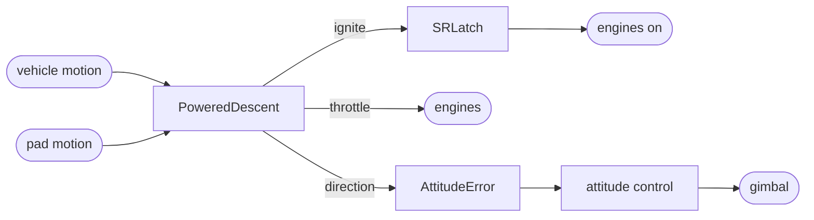

## Description

The guidance of a propulsive landing, the hover-slam. The burn starts when the height needed to
stop, braking at a planned share of full thrust, equals the height left. The throttle then
tracks the sink rate that would bring the vehicle to `v_touch` exactly at the target height. The
thrust held in reserve absorbs errors of drag, mass and timing. The `direction` output tilts the
thrust to null the horizontal offset and drift relative to the target, which turns with the Earth.

The vehicle falls, faster and faster, until its path meets the braking curve $v_{\text{ref}}(h)$
at the ignition height $h_i$. From there the throttle holds it on the curve down to $v_t$ at the
target. The dotted line is the fall without a burn; the dashed line, the braking curve above the
ignition.

## Assumptions

The planned deceleration is constant over the burn. Drag is not planned for; it only adds
margin. The vertical and lateral channels are separate: the throttle divides by the cosine of the
tilt, and the tilt is limited, and shrinks to zero near the ground for an upright touchdown. The
engines must be able to throttle down far enough to follow the plan to the end. A vehicle that
brakes on several engines and lands on fewer plans with the last engines' deceleration
(`usePlanInput`).

## Equations

Vertical channel, with the sink rate $v$, the height $h$ above the target, and the planned
deceleration $a$ ($a = \text{margin}\cdot a_{\max}-g$, or the `aPlan` input):

$$\text{ignite}:\quad \frac{\max(v,0)^2}{2a}\ge\max(h,\,0.1\text{ m})$$

$$v_{\text{ref}}=\sqrt{v_t^2+2\,a\,h},\qquad u=\frac{g+a+k_v\,(v-v_{\text{ref}})}{a_{\max}\max(\cos\vartheta,\,0.5)}\in[0,1]$$

Lateral channel, with the horizontal offset $\Delta\mathbf{r}_h$ and drift $\Delta\mathbf{v}_h$
from the target:

$$\mathbf{a}_h=-\frac{6\,s\,\Delta\mathbf{r}_h}{t_{go}^2}-\frac{4\,\Delta\mathbf{v}_h}{t_{go}},\qquad t_{go}=\max\left(\frac{2h}{v+v_t},\;t_{go,\min}\right)$$

or, with `timeToGo = false`,

$$\mathbf{a}_h=-k_d\left(\Delta\mathbf{v}_h-\mathbf{v}_c\right),\qquad \mathbf{v}_c=-\frac{k_p}{k_d}\,s\,\Delta\mathbf{r}_h\ \text{(at most } v_{\text{lat,max}}\text{)}$$

$$s=\min\left(1,\frac{h}{h_{\text{hold}}}\right),\qquad \mathbf{d}=\mathbf{u}_{\text{up}}+\frac{\mathbf{a}_h}{a_T}\min\left(1,\frac{\tan\vartheta_{\text{allowed}}\,a_T}{|\mathbf{a}_h|}\right),\qquad \vartheta_{\text{allowed}}=\vartheta_{\max}\min\left(1,\frac{h}{h_{\text{upright}}}\right)$$

| Symbol | Meaning | Unit |
|---|---|---|
| $h,v$ | Height above the target height, and sink rate (Earth-relative) | m, m/s |
| $a_{\max}$ | `aMax`: full thrust / mass of the engines running | m/s² |
| $a$ | Planned deceleration | m/s² |
| $v_t,v_{\text{ref}}$ | Sink rate at the target, and the planned sink rate at $h$ | m/s |
| $u$ | Throttle | 1 |
| $\vartheta$ | Tilt of the thrust from the vertical | rad |
| $t_{go}$ | Time to go, from the vertical plan | s |
| $s$ | Weight of the offset: 1 high up, fading below `h_hold` (1 if `h_hold` = 0) | 1 |
| $a_T$ | Thrust acceleration, $\max(\text{margin}\cdot a_{\max},g)$ | m/s² |
| $\mathbf{d}$ | `direction`: where the thrust should point | 1 |

## How to use

Latch `ignite` so the burn stays lit, feed `throttle` to the engines and `direction` to an
`AttitudeError`. Keep `margin` at 0.7 to 0.85. Keep the lateral guidance well slower than the
attitude loop: `t_goMin` sets its bandwidth, about $\sqrt6/t_{go}$. A tall vehicle should touch
down without sideways speed. Set `h_hold` so it stops drifting in the last tens of metres
wherever it is, and cut the engines on touchdown from the legs' contact force.

## Validation

`unit.aerospace` lands the `Hopper` upright and at rest within 10 m of its pad. The
`StarVesselMission_Analysis` worksheet recomputes the booster's stopping height from its speed at
ignition. The hover-slam would ask for more than 6 km, so the flight computer's height cap lights
the burn there and the denser air below makes up the rest. The worksheet also compares the ship's
six-degree-of-freedom landing with the fuel-optimal burn that `ef.optimal_control` finds for the
same vehicle.

## References

A. R. Klumpp, "Apollo lunar descent guidance", *Automatica* 10 (1974) 133–146.

L. Blackmore, "Autonomous precision landing of space rockets", *The Bridge* 46 (2016) 15–20.
