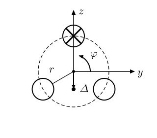

## Description

A ring of $N$ identical engines that gimbal together. One `RocketEngine` inside stands for each
of them. Their thrust points along the gimbal frame's $x$ axis, turned by the two gimbal angles.
With an engine out (`failed`), the ring gives $N-1$ times the thrust of one engine, and its
thrust centre moves away from the failed engine, which turns the vehicle.

The ring has radius $r$. The failed engine sits at the angle $\varphi$ from the $y$ axis
towards $z$. The thrust centre moves by $\Delta$, away from the failed engine.

## Assumptions

All engines in the ring run at the same throttle and gimbal together. An engine out is a
parameter of the ring's place, `failedAngle`, switched by the `failed` input. The engines' own
dynamics are those of `RocketEngine`. The thrust of the ring acts at the gimbal point.

## Equations

$$n=\begin{cases}N-1,&\text{failed}\\N,&\text{otherwise}\end{cases},\qquad T=n\,F_{\text{engine}},\qquad \dot m=n\,\dot m_{\text{engine}}$$

$$\mathbf{F}=T\left(\cos\delta_1\cos\delta_2,\;\cos\delta_1\sin\delta_2,\;-\sin\delta_1\right)$$

$$\boldsymbol{\Delta}=-\frac{r}{N-1}\left(0,\;\cos\varphi,\;\sin\varphi\right)\quad\text{with an engine out},\qquad \mathbf{M}=\boldsymbol{\Delta}\times\mathbf{F}$$

| Symbol | Meaning | Unit |
|---|---|---|
| $N,n$ | Engines in the ring, and running | 1 |
| $T,\mathbf{F}$ | Thrust of the ring, and its vector in the gimbal frame | N |
| $\delta_1,\delta_2$ | Gimbal angles (`gimbal[1]`, `gimbal[2]`) | rad |
| $r$ | `ringRadius` | m |
| $\varphi$ | `failedAngle`: place of the engine that may fail | rad |
| $\boldsymbol{\Delta}$ | Shift of the thrust centre | m |
| $\mathbf{M}$ | Moment of the shifted thrust about the gimbal point | N m |

## How to use

Put `frame_b` at the gimbal point with a `RigidBodyFrame` from the vehicle's frame. Drive the
gimbal from two actuators; for a ring that does not gimbal, feed zeros. Several rings make a
stage. The `StarshipMission` booster has a centre ring of three and an inner ring of ten that
gimbal, and a fixed outer ring of twenty. Its ship lands on a "ring" of one sea-level engine on
the axis.

## Validation

The `Hopper` in `unit.aerospace` flies and lands on a cluster with its gimbal. The thrust is
$n$ times one engine's, and the engine-out moment is $\boldsymbol{\Delta}\times\mathbf{F}$ by
construction.

## References

G. P. Sutton and O. Biblarz, *Rocket Propulsion Elements*, 9th ed., Wiley, 2017, chapter 18.
