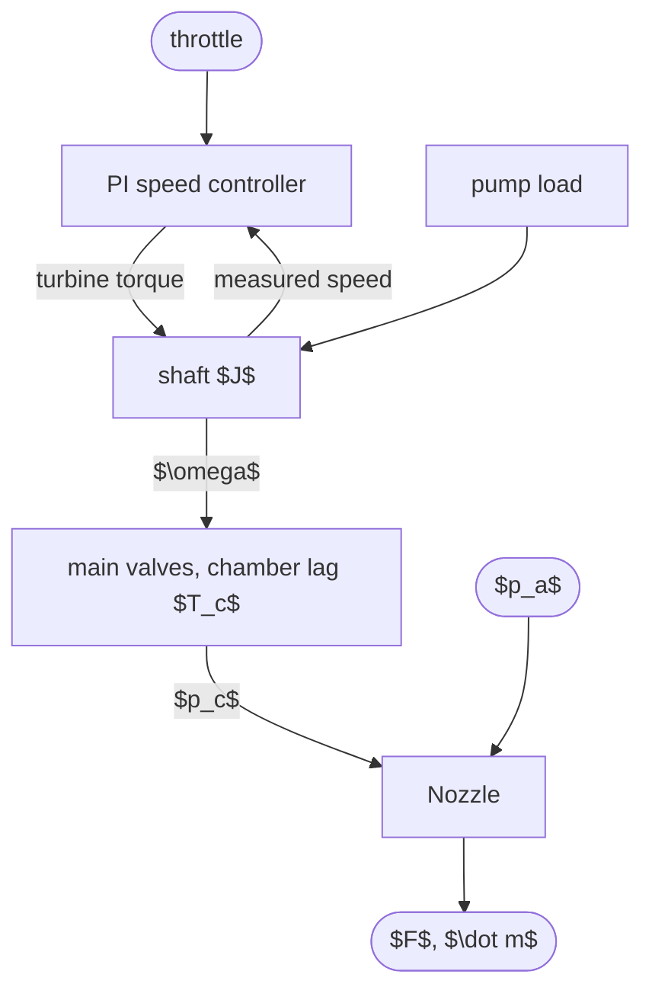

## Description

A pump-fed liquid rocket engine. The throttle sets the speed of the turbopump. A speed
controller sets the turbine torque that drives the shaft against the pump and its bearings. The
pump's flow follows its speed into the chamber, whose pressure follows with a lag. The nozzle
turns the chamber pressure into thrust, minus the ambient pressure on its exit. The delivered
specific impulse falls at low altitude, most for a vacuum nozzle.

The engine is a small diagram of library blocks: `PI`, `Torque`, `Inertia`,
`RotationalDamper`, `TurbopumpLoad`, `FirstOrder` and `Nozzle`.

## Assumptions

One shaft stands for all of the engine's turbopumps. The combustion efficiency and the mixture
ratio do not change with the throttle. The start and the shutdown follow the shaft and the
chamber lag only, with no ignition or purge sequence. While the engine is off, the speed
reference follows the shaft so the controller rests; the turbine valve and the main valves are
closed.

## Equations

$$\omega_{\text{ref}}=\omega_{\text{nom}}\,\min\left(1,\max\left(u_{\min},u\right)\right)\quad\text{while on}$$

$$J\dot\omega=\tau_t-\tau_p(\omega)-d\,\omega,\qquad \tau_t=\operatorname{PI}(\omega_{\text{ref}}-\omega)\in[0,\tau_{\max}],\qquad \tau_p=\frac{P_{\text{nom}}}{\omega_{\text{nom}}}\,\frac{\omega}{\omega_{\text{nom}}}\left|\frac{\omega}{\omega_{\text{nom}}}\right|$$

$$T_c\,\dot p_c+p_c=\begin{cases}p_{c,\text{nom}}\,\omega/\omega_{\text{nom}},&\text{on}\\0,&\text{off}\end{cases}$$

$$\dot m=\dot m_{\text{nom}}\frac{p_c}{p_{c,\text{nom}}},\qquad \dot m_{\text{nom}}=\frac{F_{\text{vac}}}{I_{\text{sp,vac}}\,g_0},\qquad F=\max\left(F_{\text{vac}}\frac{p_c}{p_{c,\text{nom}}}-p_aA_e,\,0\right)$$

$$\dot m_{\text{ox}}=\dot m\,\frac{MR}{1+MR},\qquad \dot m_{\text{fuel}}=\frac{\dot m}{1+MR},\qquad I_{\text{sp}}=\frac{F}{\dot m\,g_0}$$

| Symbol | Meaning | Unit |
|---|---|---|
| $u,u_{\min}$ | Throttle and its lowest value while running | 1 |
| $\omega,\omega_{\text{nom}}$ | Shaft speed, and its value at full throttle | rad/s |
| $J,d$ | Shaft inertia and bearing friction | kg m², N m s/rad |
| $\tau_t,\tau_p$ | Turbine and pump torque | N m |
| $P_{\text{nom}}$ | Pump power at full throttle | W |
| $T_c$ | Lag of the chamber pressure | s |
| $F_{\text{vac}},I_{\text{sp,vac}}$ | Vacuum thrust and specific impulse at full throttle | N, s |
| $MR$ | Mixture ratio, oxidiser / fuel | 1 |

## How to use

Drive `throttle` and `on` from the flight computer, and `p_amb` from `AtmosphereUS76`. Feed
`mdot_ox` and `mdot_fuel` to the tanks' `mdot_out`. For a ring of identical engines that gimbal
together, use `EngineCluster`, which contains one engine and scales it. `StaticFire` runs one
engine on a test stand with its tanks and pressurisation.

## Validation

`StaticFire` and the `StarVesselMission` ascent (`examples.model.StarVesselMission.AscentToOrbit`)
run engines through start, throttle changes and cutoff. The worksheet checks the propellant
that the booster's tanks lose up to cutoff against the integrated flow of its engine rings. The
nozzle's pressure loss is checked in `unit.aerospace`.

## References

D. K. Huzel and D. H. Huang, *Modern Engineering for Design of Liquid-Propellant Rocket
Engines*, AIAA Progress in Astronautics and Aeronautics 147, 1992.
