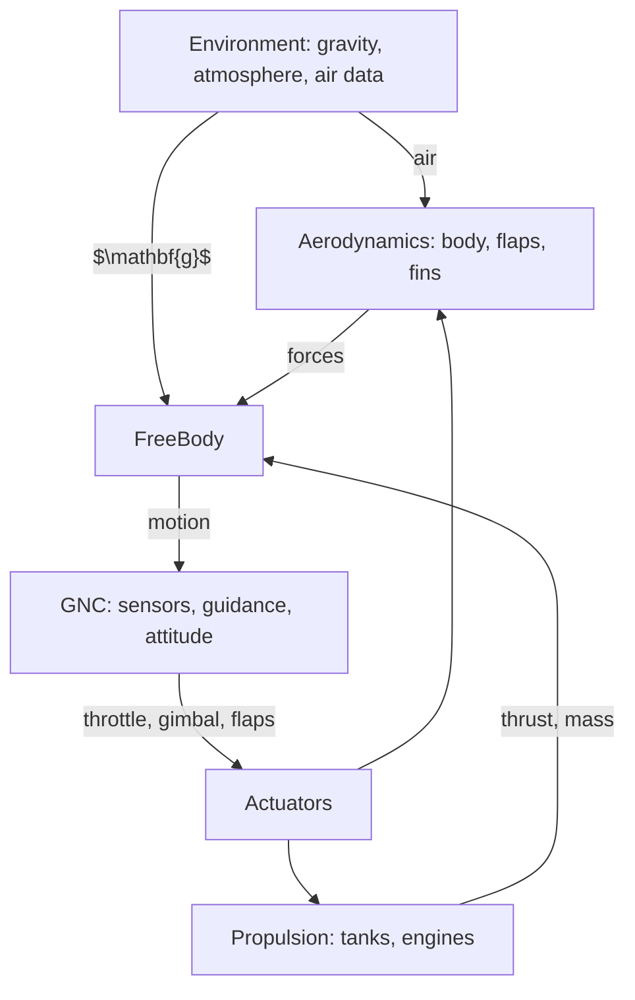

## Description

Blocks for launch vehicles and spacecraft, built around the free bodies of
`EquaForgeVC.Multibody`. The package covers the Earth that a vehicle flies over, the air it
flies through, the engines and tanks that push it, its control surfaces and actuators, and the
flight computer that steers it from lift-off to orbit, entry and a propulsive landing.

How a vehicle is put together. The environment gives gravity and, from the body's position and
airspeed, the air. Propulsion and aerodynamics push the body. The flight computer reads the
body's motion and drives the actuators.

| Category | Blocks |
|---|---|
| `Environment` | `RotatingEarth`, `LaunchSite`, `CentralGravity` (point mass and J2), `AtmosphereUS76`, `AirData` |
| `Aerodynamics` | `BodyAero` (any angle of attack), `Flap`, `GridFinSet` |
| `Propulsion` | `PropellantTank`, `TurbopumpLoad`, `Nozzle`, `RocketEngine`, `EngineCluster` |
| `Actuators` | `ElectromechanicalActuator` (a servo motor on a screw, with its air load) |
| `GNC` | `OrbitalElements`, `GroundTrack`, `IMU`, `AttitudeError`, `LocalDirection`, `VelocityDirection`, `EntryAttitude`, `ImpactPointPredictor`, `PoweredDescent` |
| `Thermal` | `StagnationHeating` (Sutton–Graves), into the lumped `EquaForgeVC.Thermal` blocks |

## Assumptions

The world frame is inertial, centred on the Earth, with $z$ towards the north pole. The Earth
turns about $z$ at $\omega_E$ and is a sphere of radius $R_e$ for altitudes. Its gravity adds
the J2 flattening term. The vehicles are rigid bodies whose mass properties change with the
propellant. Body axes put $x$ along the vehicle, towards the nose, and $y$ towards its belly.
Every block avoids events where it can (`noEvent`), so long flights stay fast.

## Equations

Each block's page gives its equations. The constants of the package are `muEarth`
($3.986004418\times10^{14}$ m³/s²), `radiusEarth` (6 378 137 m), `J2Earth`
($1.08262668\times10^{-3}$), `omegaEarth` ($7.2921159\times10^{-5}$ rad/s) and `g0`
(9.80665 m/s²).

## How to use

Start from the examples in `EquaForgeAerospace.Examples`:

- `OrbitPropagation`: a satellite in J2 gravity, with its elements and ground track.
- `StaticFire`: an engine with its tanks and turbopump on a test stand.
- `EntryHeating`: a capsule entering the atmosphere, with its heat shield's temperature.
- `Hopper`: a test vehicle that lifts off from its pad and lands again with a guided burn.

The `StarVesselMission` example in `examples/starvessel_mission` uses these blocks for a
two-stage, fully reusable launch to orbit and back.

## Validation

`unit.aerospace` checks the blocks against reference values. The atmosphere is checked against
the 1976 standard, the orbital elements against Vallado's worked example, and the orbits against
Kepler's period and the J2 node regression. The suite also checks heating against Sutton–Graves,
the nozzle's pressure loss, the attitude error and the tank's mass balance. The
`StarVesselMission_Analysis` worksheet compares a whole mission with theory.

## References

D. A. Vallado, *Fundamentals of Astrodynamics and Applications*, 4th ed., Microcosm Press, 2013.

G. P. Sutton and O. Biblarz, *Rocket Propulsion Elements*, 9th ed., Wiley, 2017.
