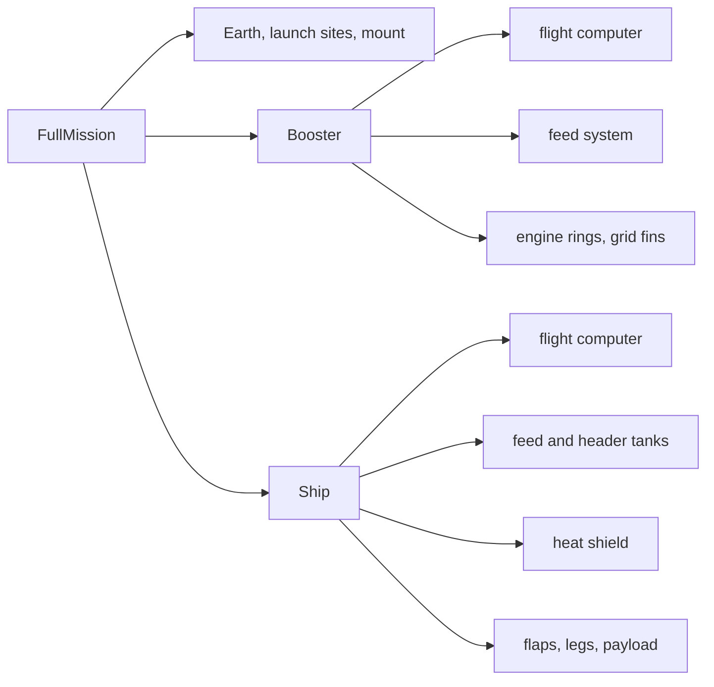
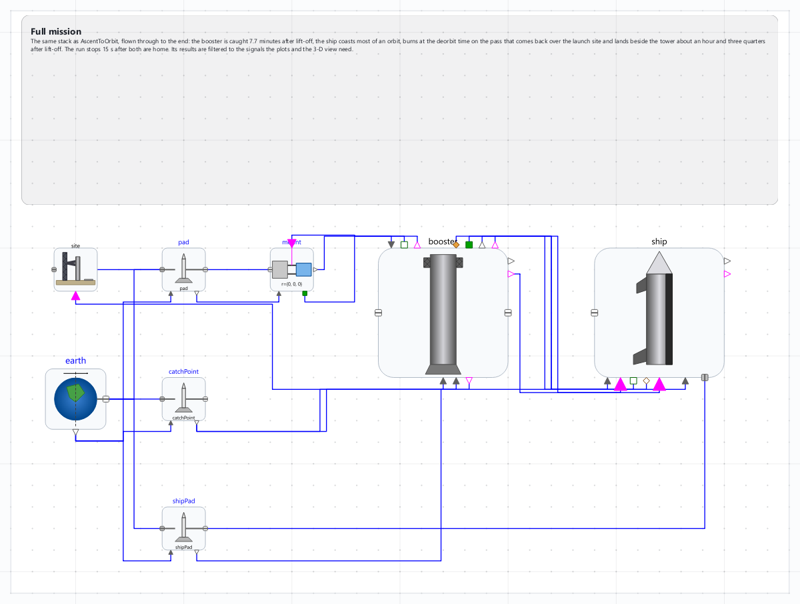
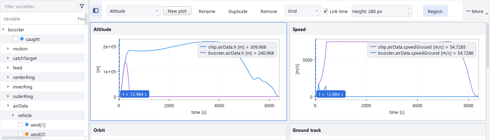
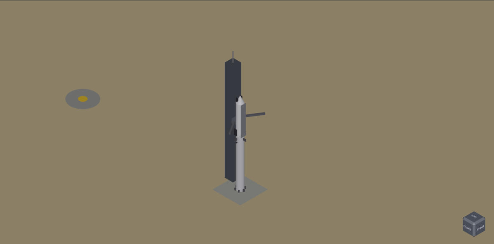
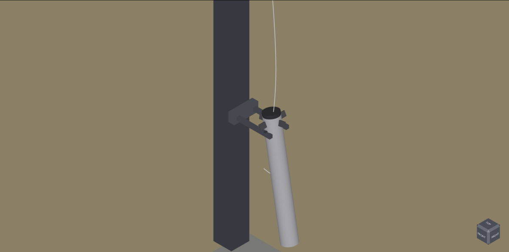
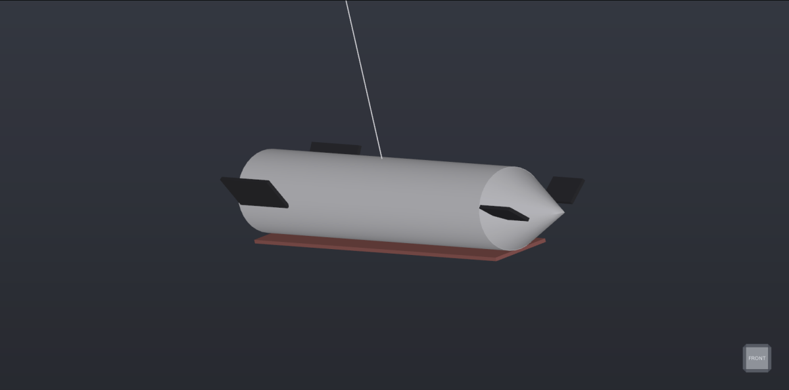
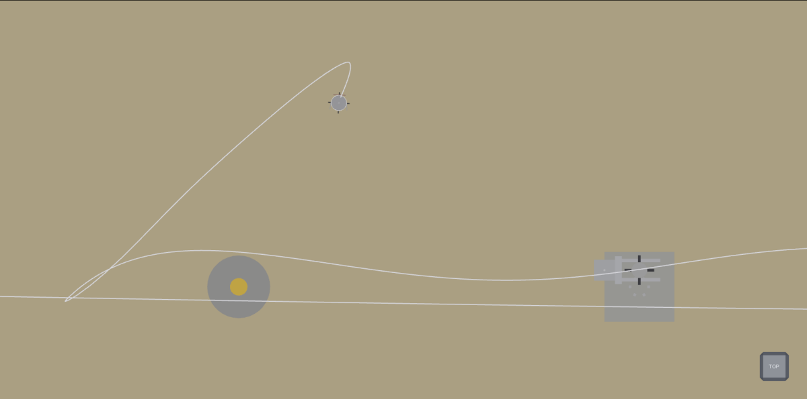
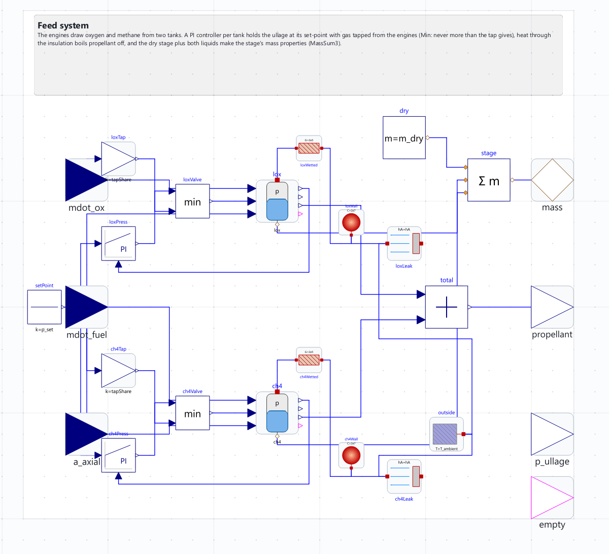
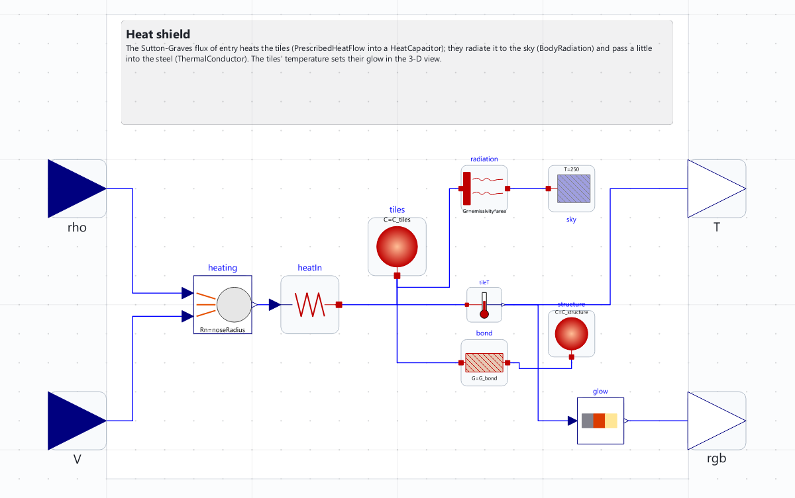

# A launch to orbit and back

This tutorial works through the study shipped with the EquaForgeAerospace toolbox: a
two-stage, fully reusable rocket that flies to orbit and brings both stages home. You run the
whole mission, look inside the vehicles, fly single segments of the flight and check the
results against theory in a worksheet. It takes about half an hour. Work through the
*Getting started* chapter of the EquaForge manual first.

> **Note:** The vehicle data are illustrative: they are rounded from public estimates for a
> fully reusable two-stage launcher, not taken from any manufacturer.

## The mission

The stack lifts off from a launch site at 26° north. The booster burns for about two
minutes, then the ship lights its engines while still on top of it (hot staging). The booster
turns round, burns back towards the launch site, falls tail-first steering with its grid fins,
and brakes into the arms of its tower. The ship flies on to a 185 × 225 km orbit and releases a
100 t payload. It coasts for most of an orbit, until its path comes back over the launch site,
and then burns to leave orbit. It enters the atmosphere belly-first, falls belly-first through
the lower air, flips upright and lands on its legs beside the tower.


*The altitude $h$ (km) of the ship (solid) and the booster (dashed) against the time $t$
(minutes) in the simulated mission. The axis is broken between 9 and 60 minutes, during the
coast. The events: 1 lift-off, 2 hot staging, 3 boostback, 4 the booster's landing burn,
5 the catch, 6 the ship's engine cutoff in orbit, 7 the deorbit burn, 8 the entry interface
(120 km), 9 the belly-flop, 10 the flip and landing burn, 11 touchdown.*

The booster is caught 7 minutes 40 seconds after lift-off; the ship lands after 106 minutes.

## How the study is built

Both vehicles are rigid bodies with six degrees of freedom on the turning Earth
(`EquaForgeVC.Multibody.BodiesAndFrames.CapturableBody`). Each has its propellant feed, engine
clusters with turbopumps, electromechanical actuators on a battery bus, aerodynamics, a heat
shield and a flight computer. The blocks come from this toolbox's library,
`EquaForgeAerospace`, and from the core library's `EquaForgeVC.Multibody`; the example
assembles them.





*The top of the study, `StarVesselMission.FullMission`. The turning Earth carries the launch pad,
the tower's catch point and the ship's landing pad. The mount holds the stack until lift-off.*

## Run the whole mission

1. In Studio, open **Settings > Libraries**, choose **Add Folder** and select the toolbox's
   folder (the one with `package.mo` and `library.json`). Then open the examples, choose
   **Studies** and the StarVessel mission (`examples/starvessel_mission`).
2. Select the model `StarVesselMission.FullMission` and choose **Simulate**. The run takes about
   15 seconds on a desktop computer.
3. The **Results** panel opens with six plots in a grid: altitude, speed, orbit, ground track,
   mass and the heat shield's temperature. The plots share their time axis.



*The first two plots of the mission: the altitudes and the speeds of the ship and the booster.
The cursor shows the values at one time.*

4. Choose **3-D View**. It opens on the launch site: the stack on its deck beside the tower, the
   land, the sea to the east and the ship's landing pad. The model asks for this view (its
   `__EquaForge(animation = ...)` annotation):
   - **site.ground axes** draws the scene in the axes of the ground plate, with east, north and
     up. The site stays level, and the paths are drawn over the ground, although the model's
     world frame is inertial and centred on the Earth. Choose **World axes** to see the flight as
     the inertial frame does: the pad then turns with the Earth and leans by the latitude.
   - The follow box keeps `ship.look.hull` in the centre: the vehicles are 70 m and 50 m long and
     fly thousands of kilometres. Choose `booster.look.hull` to ride back with the booster.

   Play the flight, or drag the time slider to an event of the
   [mission profile](#the-mission).



*Lift-off, drawn in the axes of the ground: the stack stands vertical on its deck beside the tower.
The ship's landing pad lies 230 m to the west.*



*The catch, in `TowerCatch`: the booster hangs from its two pins in the closed arms. Its grid fins
sit just above the arms.*

What to look for:

- In the **Orbit** plot, the periapsis rises above zero just before the ship's engines cut
  off: from then on the ship is in orbit.
- In the **Ground track** plot, the ship passes back over the launch site on its first orbit;
  the deorbit burn is timed for that pass.
- In the **Heat shield** plot, the tiles warm to over 1100 K during entry and cool by radiation
  as the ship slows.
- In the 3-D view, the plumes show while the engines burn. The tiles on the ship's belly glow
  with their temperature, and its flaps stand out as it falls belly-first. The tower's arms close
  on the booster when it is caught.
- The ship comes down about 120 m from its landing pad (`ship.computer.landing.offset`). Its flip
  throws it some 200 m along and across its heading. The belly-flop aims short along the heading
  only, and the landing burn removes just part of the rest.



*The belly-flop, seen from the side 6 km up: the heat shield faces the ground in the colour of its
temperature. The flaps stand out into the airflow at the angles their actuators hold.*



*The end of the mission from above, north up. The ship's track loops where the flip throws it, and
the ship stands on its legs about 120 m north-east of its pad. The booster hangs in the tower.*

The run stops 15 seconds after both vehicles are home. It records only the signals that the
plots and the 3-D view need, on a time grid that is fine during burns and coarse during the coast
(the model's `__EquaForge_Outputs` and `__EquaForge_OutputIntervals` annotations).

## Look inside the vehicles

Open the diagram of `booster` or `ship`, and further into `computer`, `feed`, `control` and
`heatShield`. Every diagram has a note that says what it does. Select a block and press **F1**
for its help page: the library's pages give each block's equations, assumptions and a figure.



*A stage's feed system (`StarVesselMission.FeedSystem`). Two `PropellantTank` blocks hold liquid
oxygen and methane. A `PI` controller per tank holds the ullage pressure with gas tapped from
the engines. Heat through the insulation boils propellant off. `MassSum3` adds the dry stage and
both liquids into the mass properties that the free body flies with.*



*The heat shield (`StarVesselMission.HeatShield`). `StagnationHeating` computes the Sutton–Graves
flux from the air density and speed. The flux heats the tiles, which radiate to the sky and pass a
little heat into the steel. The tiles' temperature colours them in the 3-D view.*

The flight computers sequence the phases with a `Logical.ModeSequencer`. Each phase selects
its own attitude target, throttle and engines. The guidance blocks come from
`EquaForgeAerospace.GNC`. `ImpactPointPredictor` ends the booster's boostback. `EntryAttitude` holds the
ship's angle of attack during entry. `PoweredDescent` times and throttles both landing burns.
`AttitudeError` turns each target into the errors of the attitude loops.

## Fly one segment at a time

The full mission is long; each part of it is also a model of its own, with its own time span,
plots and note. Use them to study one phase in detail or to change it quickly.

| Model | Span | What it shows |
|---|---|---|
| `AscentToOrbit` | 0–600 s | Lift-off, hot staging, the ship to orbit and the payload release |
| `BoosterReturn` | 0–480 s | The booster alone: boostback, the tail-first fall, the landing burn and the catch |
| `TowerCatch` | 405–480 s | The booster's last minute with the tower's mechanism: a sprung carriage, arms that close, the loads in their hinges |
| `OrbitPlanning` | three orbits | The ship as a point mass in J2 gravity: its elements, ground track and an optional Hohmann burn |
| `ShipEntryLanding` | 3900–6400 s | The ship from its parking orbit: deorbit burn, entry, belly-flop, flip and landing |
| `FullMission` | 0–6394 s | Everything in one run |
| `AutopilotPlant` | 10 s | The landing ship's pitch on one engine, for linearisation |
| `Descent3DOF` | 20 s | The landing burn as a point mass, for fuel-optimal control |

`ShipEntryLanding` starts from the ship's state in orbit, taken from a full run, so it reaches
the landing in a fraction of the time.

## Check the results in the worksheet

Open `StarVesselMission_Analysis.ipynb` from the study's folder and choose **Run All**. It takes
about a minute and a half. Each section computes a result from the simulation and compares it
with theory, and stops with an error if the two disagree:

1. Mission and vehicles: the rocket equation and the staging, worked symbolically with SymPy.
2. Ascent: the gravity and drag losses, the maximum dynamic pressure, and the feed system's mass
   balance against the engines' integrated flow.
3. Orbit: vis-viva, Kepler's period and the J2 regression of the node, a re-propagation of the
   orbit with SciPy, a Hohmann raise, and the return opportunity on the first orbit.
4. The booster's return: a sweep of the boostback's aim, the catch, and the stopping height of
   the landing burn.
5. Entry: the Sutton–Graves heating against the heat shield's model, and the tiles' temperature.
6. Landing: the fuel-optimal burn from `ef.optimal_control`, compared with the six-degree-of-
   freedom landing.
7. Autopilot: the phase margin of the landing attitude loop, from `ef.linearize`.
8. Monte Carlo: twelve catches with scattered thrust, propellant reserve and oxygen load.
9. The whole mission: its timeline and events, and the 3-D animation in the worksheet.

The sweeps translate a model once and run it many times with other parameter values:

```python
booster = ef.translate(source, model="StarVesselMission.BoosterReturn", libraries=libraries)
for bias in (-600, -350, 0):
    r = booster.simulate(stop=480, set={"booster.computer.rangeBias": bias},
                         outputs=["booster.computer.*", "booster.airData.h"])
```

The same worksheet runs from the command line:

```sh
equaforge run StarVesselMission_Analysis.ipynb -o result.ipynb
```

## Change the mission

Save the study under a new name before you change it, then try these:

- **Burn two seconds early or late.** In `ShipEntryLanding`, change `tDeorbit` from 4108.5 s to
  4106.5 s or 4110.5 s. The ship's entry steering removes only part of the error: it now lands
  upright 8 to 10 km from its pad (watch `ship.computer.landing.offset`). Section 3 of the
  worksheet shows how the burn time was found.
- **Aim the boostback differently.** In `BoosterReturn`, change `rangeBias` of `booster` from
  −350 m to 0 m. The boostback then aims at the tower as if there were no air, and drag
  shortens the fall: the booster comes down about 180 m from the arms and is not caught.
- **Raise the orbit.** In `OrbitPlanning`, set `tBurn` to 600 s and `dvBurn` to 30 m/s. The
  prograde burn lifts the far side of the orbit: the apoapsis grows by about 100 km while the
  periapsis stays where it was.
- **Read a block's equations.** Select `landing` in either flight computer and press **F1**:
  the page of `PoweredDescent` explains when the burn starts and how its throttle follows the
  braking curve.

The worksheet is the check for every change: run it again, and its assertions say whether the
mission still closes.
